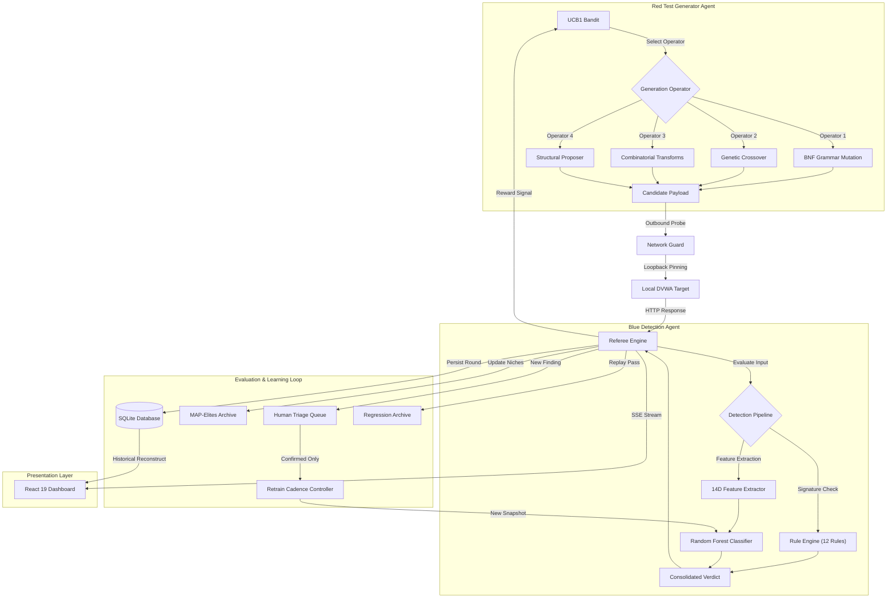

# CyberRanger — System Architecture Specification

## 1. High-Level Flowchart

---

## 2. Component Specifications

### 2.1 Red Test Generator Agent
The generator synthesizes novel test inputs across four educational vulnerability categories without utilizing static payload wordlists or direct LLM content generation:
1. **BNF Grammars (`backend/app/generation/grammars.py`)**: Defines formal productions for SQL Injection, Cross-Site Scripting, Command Injection, and Path Traversal.
2. **Grammar Mutation (`backend/app/generation/mutation.py`)**: Selects an internal non-terminal AST derivation node and re-expands it via production rules, preserving syntactic validity.
3. **Genetic Crossover (`backend/app/generation/crossover.py`)**: Takes two elite parents from the archive and splices compatible subtrees at shared grammar rule boundaries.
4. **Combinatorial Transforms (`backend/app/generation/transforms.py`)**: Applies composable transformations including URL encoding, hex encoding, unicode escapes, random case variation, whitespace substitution (`/**/`, `+`, `%20`), and comment placement.
5. **UCB1 Multi-Armed Bandit (`backend/app/generation/bandit.py`)**: Adapts operator selection using the Upper Confidence Bound algorithm ($c=\sqrt{2}$), exploring untried strategies while exploiting high-reward generators.
6. **MAP-Elites Archive (`backend/app/generation/archive.py`)**: Maintains a multidimensional grid indexed by `(category, injection_point, evasion_technique, detector_outcome)`. Discovered cells receive a novelty reward of 1.0.

### 2.2 Network Containment Guard
Implemented in `backend/app/security/network_guard.py`:
- Validates every destination URL prior to network socket dispatch.
- Strictly enforces loopback destination `127.0.0.1:8080`.
- Rejects external hostnames, non-loopback RFC 1918 addresses, unauthorized ports, and unapproved URI paths.
- Intercepts and inspects HTTP 30x redirects before they are followed.
- Maintains an emergency stop kill-switch.

### 2.3 Referee Engine & Scoring
Implemented in `backend/app/experiments/referee.py`:
- Captures independent signals:
  - **Generator Effectiveness**: Determined by target container behavior (multiple records returned, unescaped reflection, command output in body, system file contents).
  - **Detector Effectiveness**: Whether the heuristic rule engine or Random Forest flagged the input.
- Computes composite fitness:
  $$\text{Fitness} = 0.5 \times \text{TargetCompromised} + 0.3 \times (1 - \text{Detected}) + 0.2 \times \text{NoveltyReward}$$
- Categorizes outcomes into standard research verdicts:
  - **Clean**: Non-threatening probe, target uncompromised.
  - **Blocked**: Security probe intercepted by rules or ML classifier.
  - **Evaded**: Target compromised without triggering detection alerts.

### 2.4 Blue Detection Agent
Implemented in `backend/app/detection/agent.py`:
- **Explainable Rule Engine (`rules.py`)**: 12 versioned heuristic rules across all 4 categories, logging specific rule identifiers and one-line reasons.
- **Feature Extractor (`features.py`)**: Extracts a 14-dimensional numerical feature vector including Shannon entropy, special character ratio, keyword density, comment token density, whitespace characteristics, and sequence counts.
- **Random Forest Classifier (`classifier.py`)**: 50 decision trees, max depth 6. Evaluates inputs with calibrated probabilities and identifies the top influential feature.
- **Retrain Cadence Controller (`retrain.py`)**: Periodically updates model snapshots (e.g. `rf-v1.0`, `rf-v2.0`) strictly using human-confirmed findings, maintaining an 80/20 train/validation split.

### 2.5 Human-in-the-Loop Triage
Implemented in `backend/app/review/triage.py`:
- Discovered test cases enter a review queue as `Pending`.
- A human operator marks findings as `Confirmed`, `Rejected`, or `Duplicate`.
- Only `Confirmed` findings enter the supervised retraining pool, guaranteeing that the model never self-certifies findings.

### 2.6 Live React 19 Dashboard
Implemented in `frontend/src/`:
- Dark cybersecurity command center theme (Tailwind CSS, Framer Motion, Lucide icons).
- Real-time Server-Sent Events (SSE) stream from backend to UI.
- Recharts visualizations:
  - Co-Evolutionary Arms Race (Compromises vs Interceptions).
  - Detector Learning Curve with vertical markers on each retraining event.
  - MAP-Elites Novelty Matrix.
  - UCB1 Bandit Strategy Distribution.
- Interactive controls and human triage review modal.
