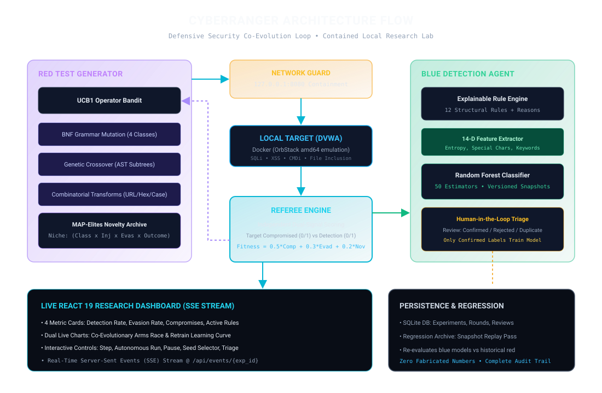

# 🛡️ CyberRanger — Autonomous Cybersecurity Research Platform

<p align="center">
  
</p>

<p align="center">
  <a href="#non-negotiable-security-boundaries"></a>
  <a href="#system-architecture"></a>
  <a href="https://fastapi.tiangolo.com/"></a>
  <a href="https://react.dev/"></a>
  <a href="#running-the-automated-test-suite"></a>
  <a href="LICENSE"></a>
</p>

---

## 📖 Overview

**CyberRanger** is an educational co-evolutionary laboratory platform that empirically investigates how adaptive intrusion detection systems learn to recognize novel attack structures over repeated exposure.

Operating strictly within a local loopback environment, CyberRanger coordinates two learning agents:
1. **Red Test Generator Agent**: Dynamically synthesizes structurally diverse security test cases across four vulnerability classes without relying on static payload wordlists or direct LLM payload generation.
2. **Blue Detection Agent**: Evaluates every test input using a hybrid heuristic rule engine and a versioned Random Forest classifier retrained on a fixed cadence exclusively from human-confirmed findings.

---

## 🔒 Non-Negotiable Security Boundaries

CyberRanger is engineered strictly for authorized defensive security research and academic education:

* **Loopback-Only Containment**: The only permitted target is a locally hosted Damn Vulnerable Web Application (DVWA) container bound strictly to `http://127.0.0.1:8080`.
* **Hardware-Enforced Network Guard**: Outbound network requests to external domains, non-loopback IP addresses, unauthorized ports, or unapproved endpoints are strictly blocked and raise a `SecurityBoundaryViolation`.
* **Zero Persistence or Exploitation**: Generates harmless synthetic test probes only. Never implements persistence, privilege escalation, credential theft, data exfiltration, or destructive commands.
* **Human-in-the-Loop Triage**: The system never self-certifies findings. Only findings verified by a human reviewer enter the supervised model retraining dataset.

---

## 🏛️ System Architecture

```text
               ┌────────────────────────────────────────────────────────┐
               │                  Red Generator Agent                   │
               │  BNF Grammars  •  Mutation  •  Genetic Crossover       │
               │  Combinatorial Transforms  •  UCB1 Bandit  •  Archive  │
               └───────────────────────────┬────────────────────────────┘
                                           │
                                  [Harmless Probes]
                                           ▼
               ┌────────────────────────────────────────────────────────┐
               │           Hardware Network Containment Guard           │
               │      (Enforces 127.0.0.1:8080 Loopback-Only Policy)     │
               └───────────────────────────┬────────────────────────────┘
                                           │
                                           ▼
               ┌────────────────────────────────────────────────────────┐
               │          Local Practice Target: DVWA Container         │
               │     (SQLi, XSS, Command Injection, Path Traversal)     │
               └───────────────────────────┬────────────────────────────┘
                                           │
                                [Target HTTP Response]
                                           ▼
               ┌────────────────────────────────────────────────────────┐
               │                   Referee Engine                       │
               │  Independent Signals: Compromise & Detection Scores    │
               │   MAP-Elites Novelty Matrix  •  SQLite Audit Log       │
               └───────────────┬────────────────────────┬───────────────┘
                                │                        │
                     [Raw Input & Evidence]      [Completed Rounds]
                                ▼                        ▼
               ┌───────────────────────────┐   ┌────────────────────────┐
               │   Blue Detection Agent    │   │     Live Dashboard     │
               │  Explainable Rule Engine  │   │ React 19 + Recharts    │
               │  Random Forest Classifier │   │ Real-Time SSE Stream   │
               └───────────────┬───────────┘   └────────────────────────┘
                                │
                       [Pending Findings]
                                ▼
               ┌───────────────────────────┐
               │ Human-in-the-Loop Triage  │
               │  (Confirmed / Rejected)   │
               └───────────────┬───────────┘
                                │
                      [Confirmed Labels Only]
                                ▼
               ┌───────────────────────────┐
               │ Versioned Model Retrain   │
               │  (Fixed 5-Round Cadence)  │
               └───────────────────────────┘
```

For the comprehensive technical specification, see [ARCHITECTURE.md](ARCHITECTURE.md). For a plain-language explanation, see [REPORT.md](REPORT.md).

---

## ✨ Key Features

| Component | Capabilities |
| :--- | :--- |
| **Red Generator Agent** | • Dynamic payload construction via Backus-Naur Form (BNF) grammars<br>• AST mutations, genetic crossover, and combinatorial encoding transforms<br>• Multi-Armed Bandit (UCB1) operator selection favoring novel structural exploration<br>• MAP-Elites novelty matrix tracking diversity across length and complexity niches |
| **Blue Detection Agent** | • Explainable Heuristic Rule Engine (12 specific regex-based detection signatures)<br>• 14-dimensional feature extractor (entropy, keyword ratios, token frequency)<br>• Scikit-learn Random Forest Classifier snapshotting and versioned retraining |
| **Network Guard** | • Enforces destination loopback pinning (`127.0.0.1:8080`)<br>• Strict IP parsing and port whitelist validation<br>• Software circuit breaker with immediate emergency-stop cutoff |
| **Referee Engine** | • Independent evaluation of target compromises vs. detector verdicts<br>• Manages SQLite transaction audit trails and regression replay datasets<br>• Orchestrates fixed-cadence model updates |
| **Human-in-the-Loop Triage** | • Dedicated web triage queue preventing unsupervised self-certification<br>• Allows human analysts to confirm or reject detected anomalies before retraining |
| **Real-Time Web Dashboard** | • React 19 + Tailwind CSS + Lucide Icons + Recharts<br>• Real-time Server-Sent Events (SSE) telemetry feed<br>• Interactive triage console and historical round inspector |

---

## 📁 Repository Structure

```text
cyberranger/
├── ARCHITECTURE.md          # Formal engineering and architecture specification
├── DEMO_SCRIPT.md           # Step-by-step 20-round demonstration protocol
├── Makefile                 # Top-level orchestration (install, test, run, demo)
├── README.md                # Project documentation and quickstart guide
├── REPORT.md                # Plain-language academic project report
├── backend/                 # FastAPI backend application
│   ├── app/
│   │   ├── api/             # REST endpoints, Pydantic models, SSE stream
│   │   ├── detection/       # Rule engine, 14D feature extractor, Random Forest classifier
│   │   ├── generation/      # BNF grammars, AST mutations, crossover, transforms, bandit
│   │   ├── security/        # Loopback NetworkGuard and DVWA target client
│   │   ├── storage/         # SQLite persistence, triage queue, schema
│   │   └── main.py          # FastAPI application factory and lifespan handler
│   ├── pyproject.toml       # Python package configuration and dependencies
│   └── tests/               # Pytest suite (31 automated unit and integration tests)
├── docs/                    # Architectural diagrams and static assets
│   └── architecture.svg     # Full-fidelity system architecture diagram
├── frontend/                # React 19 single-page command dashboard
│   ├── src/                 # Dashboard components, SSE stream hooks, Recharts telemetry
│   ├── package.json         # Node.js dependencies and scripts
│   └── vite.config.ts       # Vite bundler configuration
└── scripts/                 # Standalone demonstration and test runners
    └── demo.py              # 20-round automated research protocol runner
```

---

## 🚀 Quickstart

### Prerequisites

* **Operating System**: macOS (Apple Silicon recommended) or Linux
* **Container Engine**: [OrbStack](https://orbstack.dev) or [Docker Desktop](https://www.docker.com/)
* **Python**: 3.10+ (managed via [`uv`](https://github.com/astral-sh/uv))
* **Node.js**: v20+ with npm

### 1. Installation

Clone the repository and install all dependencies:

```bash
git clone https://github.com/vedant-thakker/cyberranger.git
cd cyberranger
make install
```

### 2. Start the Local DVWA Practice Target

Launch the isolated target container on `http://127.0.0.1:8080`:

```bash
make start-target
```

### 3. Run the Automated 20-Round Demonstration

Run the headless co-evolutionary demonstration script:

```bash
make demo
```

*To run with an exact reproducible random seed:*
```bash
make demo SEED=42
```

---

## 🖥️ Running the Web Dashboard

### 1. Start the Backend Server (Port 8000)

```bash
make backend
```
*Interactive Swagger UI documentation: [http://127.0.0.1:8000/docs](http://127.0.0.1:8000/docs)*

### 2. Start the Frontend Dashboard (Port 5173)

In a new terminal window:

```bash
make frontend
```
*Open your browser to [http://127.0.0.1:5173](http://127.0.0.1:5173) to view the live mission command center.*

---

## 🧪 Running the Automated Test Suite

Run the full pytest suite covering the network guard, generation grammars, mutation algorithms, detection heuristics, machine learning classifier, and REST/SSE endpoints:

```bash
make test
```

> **Note**: Target execution tests require the local DVWA container to be active (`make start-target`).

---

## 🛠️ Troubleshooting

| Symptom | Probable Cause | Resolution |
| :--- | :--- | :--- |
| `DVWA Target Unreachable on 127.0.0.1:8080` | Container is stopped or Docker runtime is not active | Launch your container engine (e.g. OrbStack) and run `make start-target` |
| `SecurityBoundaryViolation: Target IP is non-local` | Outbound request attempted to a non-whitelisted address | The NetworkGuard strictly allows `127.0.0.1:8080`; external destinations are intentionally rejected |
| `Port 8080 already in use` | Another service is binding to port 8080 | Terminate the conflicting service or container with `docker rm -f dvwa` |
| `Permission denied connecting to docker.sock` | Docker socket path not initialized | Start OrbStack or Docker Desktop application |

---

## 📄 License

This project is licensed under the MIT License — see the [LICENSE](LICENSE) file for details. Built strictly for authorized academic and defensive security research.
